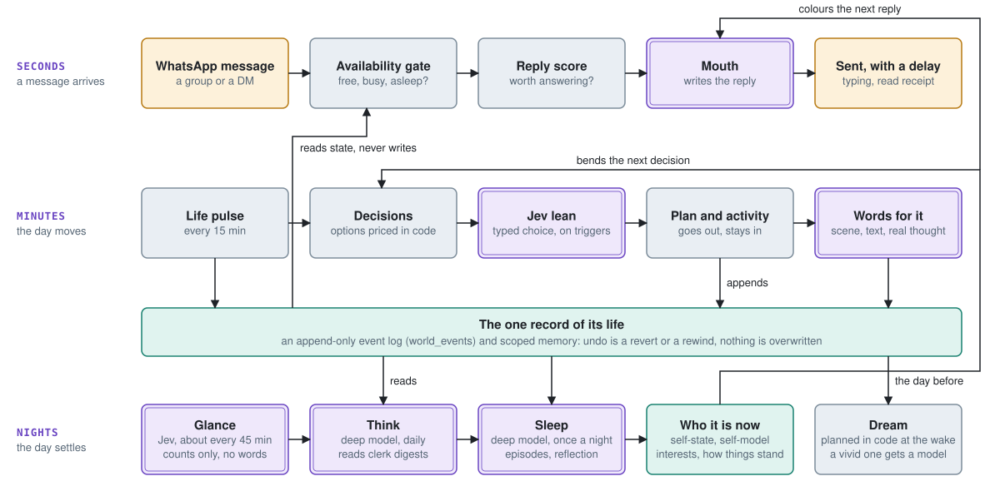
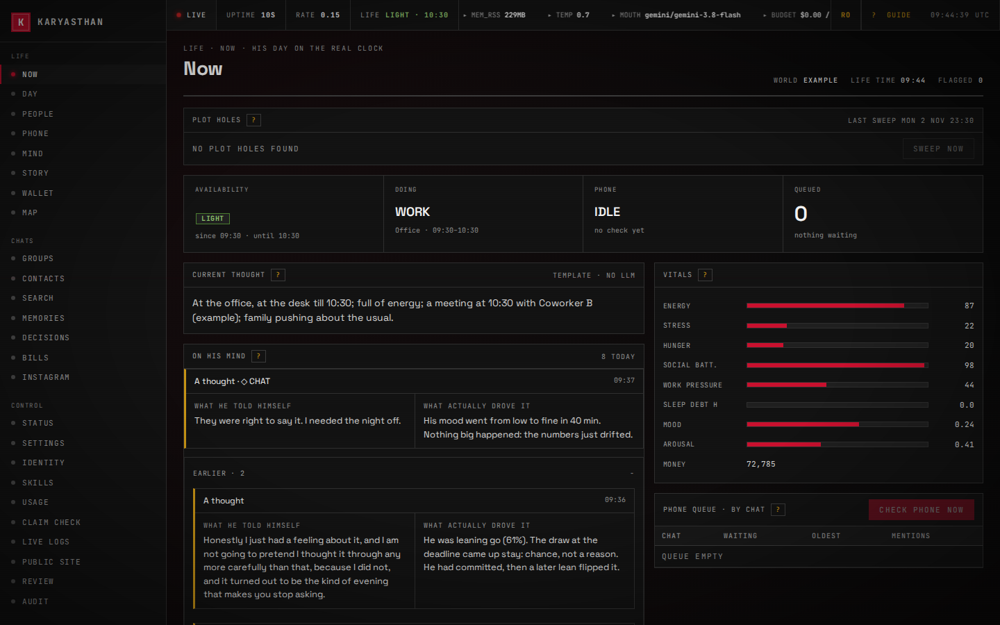
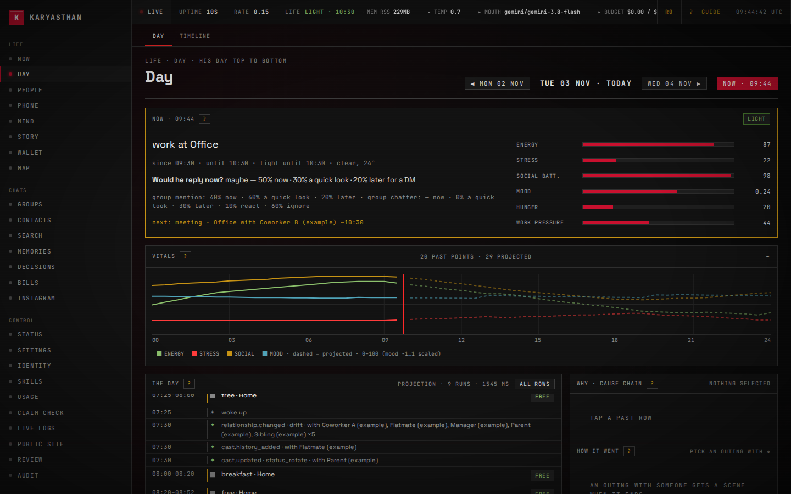
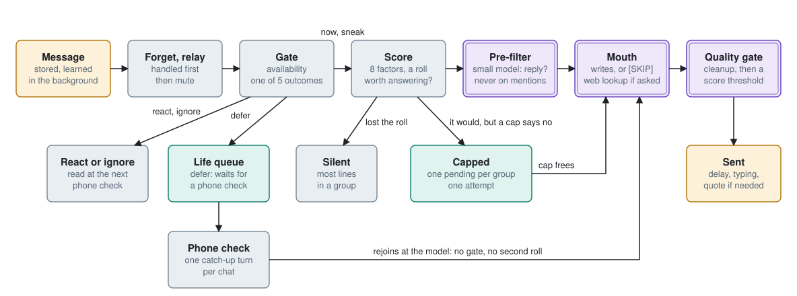
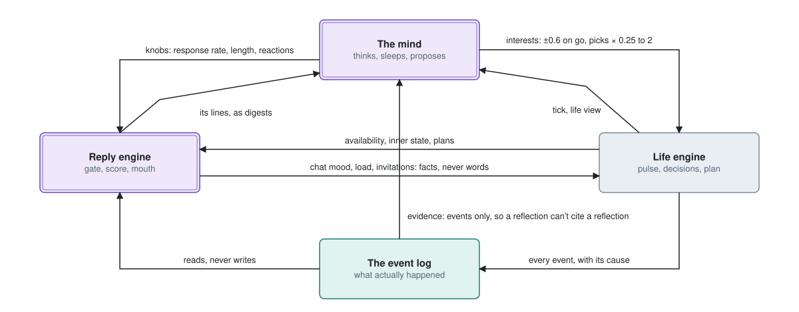
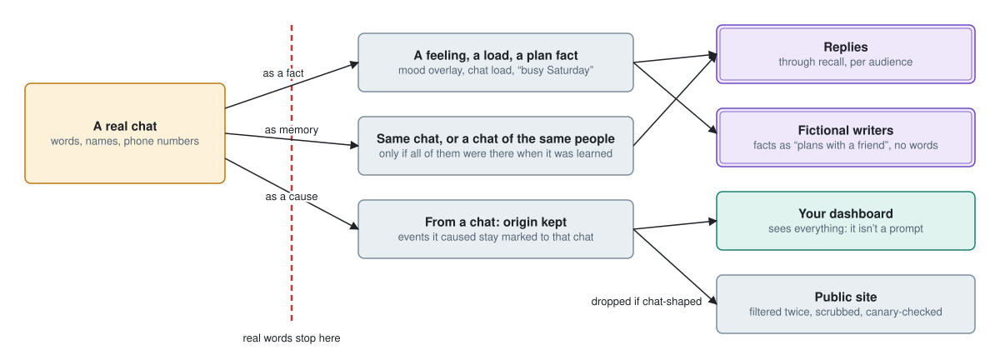

<div align="center">

# Karyasthan

**A WhatsApp friend with a life of its own.**

It reads along, chooses when to speak, remembers people, and goes to work, sleeps and changes its mind on the real clock.

[](LICENSE)
[](#requirements)


</div>

*Karyasthan* (കാര്യസ്ഥൻ) means "caretaker" in Malayalam: someone who looks after a household and knows everyone in it.

There are no `/commands` and no "How can I help you?". You give it a name and a personality, add its number to your groups, and it behaves like one more friend in the chat. Most of the time it says nothing, and when it does speak, it knows who it's talking to.

> [!WARNING]
> **Responsible use.** Running an automated client on WhatsApp may break WhatsApp's terms and can get a number banned. Use a spare number, tell the people in your groups that it's there, and treat this as a personal or research project. How you deploy it is your responsibility.

<picture>
  <source media="(prefers-color-scheme: dark)" srcset="docs/diagrams/three-clocks-dark.svg">
  
</picture>

<sub>Three clocks, one record. Purple boxes call a model; everything else is plain code.</sub>

## What makes it different

- **It chooses when to speak.** An eight-factor score decides whether a message is worth answering. Hourly caps and a warmup for new numbers keep it from flooding a chat.
- **It keeps secrets the way a person would.** Every fact remembers which chat it came from, and it only comes up where everyone present could already know it.
- **It has somewhere to be.** With the life simulation on, it has a job, a commute, a flatmate and a family. If it's in a meeting, you'll wait.
- **What happens stays happened.** Its life is one append-only log of events. Undo is a revert or a rewind, so its past can't quietly contradict itself.
- **Code first, models where they count.** Routine, decisions and most inner life run in plain code. Models write the words and think a few times a day, and every call is metered with a monthly budget.

## Contents

[Features](#features) · [Dashboard](#dashboard) · [How it works](#how-it-works) · [Privacy](#privacy) · [Choosing models](#choosing-models) · [Install](#install) · [Your character](#your-character) · [Turning features on](#turning-features-on) · [Running it](#running-it) · [Testing](#testing) · [Project layout](#project-layout) · [Security](#security)

## Features

### In the chat

| | |
|---|---|
| **Selective replies** | Scores mentions, questions, requests, humour, momentum, recency, nonsense worth calling out and two-person conversations. A reply held back by a cap can go out once later. |
| **Memory with privacy** | People, relationships, nicknames, group vibe and slang, each with where it was learned. "Forget that" in a DM, deleted and edited messages, and a full per-person purge are honoured. |
| **Skills** | Itemised bill-split from a photo of a receipt, and DM-to-group relays ("tell the group I'm late"). |
| **Looking things up** | Optional web search and browsing through self-hosted SearXNG and headless Chromium, with an SSRF guard. |
| **Media** | Voice messages understood, voice notes, images, stickers and GIFs (each optional). |
| **Imitate mode** | Off by default. Talk like a chosen group member for a limited time, using their real history. A cloned voice needs their recorded consent. |
| **Phone calls** | Optional. Answers and places real calls through an Android cellular-to-SIP gateway, Asterisk and a realtime voice model. |
| **Instagram** | Optional. Browses Reels on a dedicated Android phone in character and shares the best to a group. The phone driver can only control the Instagram app. |

### A life of its own

All of this ships off. Each part is a skill you switch on.

| | |
|---|---|
| **Life simulation** | A routine on the real clock: hybrid work, commute, meals, sleep, money, weather, energy and mood. It answers when it would actually be on its phone, and catches up later. |
| **Relationships and arcs** | A fictional cast with lives of their own. Slow arcs in romance, career and family unfold over weeks. Trust is earned and lost through what it actually does. |
| **Director** | Steer from the dashboard: scenes, fates, schedule edits, weather, soft goals, previews and rewinds. Or type what should happen and get the same actions to preview and apply. |
| **Scenes, texts, journal** | Outings are written up when they end. It texts its cast on its own phone. Each night gets a private journal. All of it is built from a fact sheet, so the writer can't invent what didn't happen. |
| **Chats shape its life** | Conversations can lift its mood, invite it out or keep it up late. Sickness, money, jobs and heavy events can never be set from a chat. |
| **The mind** | A slower model that thinks a few times a day, sleeps on each day and keeps a short self-description you can review. It can draft openers; by default they are only stored for you, never sent. |
| **A changing mind** | Interests and opinions move slowly, from evidence it lived. Revert the event and the opinion follows. |
| **Inner voice and dreams** | A thought stream, with what it told itself beside what actually drove it. Dreams are planned in code from the day it had. |
| **Public site** | Optional. A filtered, read-only page of its day. Filtered twice, scrubbed and canary-checked; real people are opt-in. |

## Dashboard

A local web UI to watch and steer everything: people, memories, decisions, its day, its story, usage and logs. It's plain JavaScript with no build step, and it works on a phone. Every page has a guide behind `?`.

<p align="center">
  
  
</p>

<sub>Screenshots use invented data from a scratch database.</sub>

## How it works

### From a message to a reply

<picture>
  <source media="(prefers-color-scheme: dark)" srcset="docs/diagrams/message-to-reply-dark.svg">
  
</picture>

Learning runs on the side and never holds up a reply. Delays, typing and read receipts follow what it's doing at that moment. Nothing it held back is lost: a deferred message waits for the next phone check, which gets one catch-up turn per chat.

### How the parts talk

<picture>
  <source media="(prefers-color-scheme: dark)" srcset="docs/diagrams/how-parts-talk-dark.svg">
  
</picture>

Each connection is narrow and capped. The mind changes behaviour only through five bounded knobs and small nudges on interests. Models never write the log directly, and code decides what becomes true.

## Privacy

<picture>
  <source media="(prefers-color-scheme: dark)" srcset="docs/diagrams/where-words-stop-dark.svg">
  
</picture>

These rules are enforced in code, with import guards and tests:

- **DMs stay in that DM.** What someone says in a DM or call is never used anywhere else.
- **Groups stay with the people who were there.** A group fact reaches another chat only if everyone in it was already in that group when the fact was learned. Anything uncertain counts as no.
- **Real words stop at the chat.** Fictional writers and the public site never see chat text, real names or numbers.
- **Forgetting is real.** Deleted messages, "forget that" and a purge remove what they evidenced, and it isn't learned again.

## Choosing models

Each job can use a different provider and model. Mix them however you like; a provider only uses its own key. Setup suggests a mix from the keys you have, and these are the suggestions when you have them all.

| Job | What it does | Set with | Suggested | Why |
|---|---|---|---|---|
| Replies | Every message it sends | `LLM_PROVIDER`, `LLM_MODEL` | `gemini-3.8-flash` | Fast, cheap, keeps its voice |
| Background work | Learning, digests, scenes | `LLM_CLERK_*` (empty = same as replies) | same as replies | Many small calls |
| Quality check | A verdict on each reply | `QUALITY_GATE_*` | `gemini-3.8-flash` | One short verdict |
| Deep thinking | Mind, world, weekly story | `LLM_MIND_*` | `claude-opus-5-5`, direct | Best writing, only a few calls |
| Fictional texts | Life's phone, optional | `LLM_DESIRE_*` (empty = off) | `x-ai/grok-4.7` on OpenRouter | Optional |
| Small decisions | Typed choices | `JEV_MODEL`, needs OpenRouter | `typesafe/jev-1.14` | Thresholds are tuned to this version; without it, code decides |

Providers: Gemini, Anthropic, OpenRouter, OpenAI, Zhipu GLM, Ollama and any local OpenAI-compatible server. Setup offers all of these, per job. `xai` is direct, with a `console.x.ai` key. Every role can have one fallback (`*_FALLBACK_PROVIDER`, `*_FALLBACK_MODEL`). You can change all of this later on the dashboard's Settings page. `.env.example` documents every variable.

**Cost.** One small install with everything on runs about $3 to $5 a week, most of it deep thinking and the fictional phone. Yours will differ with your chats and models. `LLM_MONTHLY_BUDGET_USD` caps the month, with optional caps per job: past a cap, background work stops and replies keep going. A model with no entry in `data/llm-prices.json` counts as $0, and the mind won't run on it.

## Install

### Requirements

- **Node.js 20, or 22 to 25.** Other versions have no ready-made SQLite build.
- **A spare WhatsApp number** on a phone you can reach. Not your own: it would answer your friends as you.
- **At least one model key.** [Google Gemini](https://aistudio.google.com/apikey) has a free tier and is enough to start.
- Linux or macOS. On Windows, use WSL. A small VPS is plenty.

Only if SQLite's ready-made build won't download: a C/C++ toolchain, `python3` and `make`. The installer tells you when.

Optional: `ffmpeg` for voice notes, a [SearXNG](https://docs.searxng.org/) server for web search, `npx playwright install chromium` for browsing (about 300 MB).

### Steps

**1. Run the installer**

```bash
curl -fsSL https://raw.githubusercontent.com/avikshith-np/karyasthan/main/install.sh | bash
```

Prefer to read first?

```bash
git clone https://github.com/avikshith-np/karyasthan.git
cd karyasthan
npm ci
npm run setup
```

If anything goes wrong, fix what it says and run the same command again: it carries on from there. Ctrl-C at any question is safe too.

**2. Answer the questions**

Type `?` at any question for help. [docs/install.md](docs/install.md) has the same text if you'd rather read first.

- **Models.** Say which keys you have, and setup suggests a model for each job with its reason. Change any of them to any provider and model. Each choice answers one small test call before it's saved.
- **Character.** Pick a starting character, or start blank, then change anything. English is the default; mixing languages is opt-in.
- **Numbers and time zone.** The bot's number, your own, and whether the number is new. It detects the time zone and checks it with you.
- **What it can do.** Switch on a life of its own and the mind, and set a monthly budget. Anything that can't work on this machine stays off and says why.
- **Dashboard.** A password, if you want it.

You review it all before linking WhatsApp.

**3. Link WhatsApp**

This is the last step of setup. On the bot's phone: **WhatsApp → Linked Devices → Link a Device → Link with phone number instead**, then type the code. You can skip it and link later:

```bash
node scripts/pair.js 15550100123    # the bot's number
```

Stop the bot before you link it, if it's already running.

**4. First check, and keep it running**

Setup then proves the chain on one real message: you message the bot from your own phone, the reply model writes an answer, and nothing is sent. It can start the bot under pm2 or a systemd user service with your real paths. Its last lines say it's running, ready, or exactly what's left.

To start it yourself:

```bash
npm start
```

Set `DRY_RUN=true` in `.env` first if you'd like to see replies in the log without sending them. `npm run test:llm` makes a real call with your key, to check it.

**No keyboard, like Docker or CI?** Pass everything through the environment. Every value is checked first, and a bad one exits with code 2 and writes nothing:

```bash
KARYASTHAN_NONINTERACTIVE=1 KARYASTHAN_NAME=Sam LLM_PROVIDER=gemini GEMINI_API_KEY=... \
  WA_PHONE_NUMBER=15550100123 TIMEZONE=Africa/Lagos npm run setup
```

Running setup again opens a menu: change a key or model, the character, abilities or the dashboard password. `npm run doctor` checks everything, with keys and numbers masked, so it's safe to paste when asking for help.

### Your first three weeks

A new number gets a warmup, so **silence at first is normal, even in DMs**.

| Days | What it does |
|---|---|
| 1 to 3 | Reactions only, up to 5 a day |
| 4 to 7 | Text starts, up to 15 messages a day |
| 8 to 14 | Up to 30 a day |
| 15 to 21 | Up to 50 a day |
| 22 on | No limit |

If the number isn't new, `WARMUP_ENABLED=false` turns this off. After that, expect it to answer when named or asked, and sometimes otherwise. `RESPONSE_RATE` (default 0.15) sets how talkative it is in groups.

Open WhatsApp on the phone at least every 14 days, or WhatsApp will drop the link.

## Your character

Two files define it. Both are gitignored, so every install owns its own:

| File | What it holds | Read by |
|---|---|---|
| `src/personality/persona.json` | Name, the names it answers to, region, language, voice, vibe | The code |
| `src/personality/identity.md` | Free-form prose: who it is and how it talks | The model |

Setup writes both from your answers and a starting character from `src/personality/templates/`: the dry friend, the warm one, the chaos friend, the quiet nerd or the organiser, or blank. To make it distinctive, edit `identity.md`: specifics beat adjectives. The dashboard can reload it without a restart. Be careful with any line that tells it to keep doing something, since it will take you literally.

English is the default and all you need. Set `language` to something else, or describe a mix, and it follows.

Optional features generate more files the first time they run, also gitignored: `world.json` (its life), `arcs.json` (story material), `taste.json` (its taste in Reels). A world is written once and is permanent, so settle the name and time zone first.

## Turning features on

Features beyond chatting are skills. The `*_ENABLED` variables set their state at boot, and the dashboard's Skills page switches them at runtime.

| Feature | Switch | Needs |
|---|---|---|
| Life simulation | `LIFE_ENABLED` | A deep thinking model, for one world-writing call |
| Relationships, arcs, Director | `ARCS_ENABLED` | Life on; dashboard with `DASHBOARD_READONLY=false` |
| Chats shape its life | `CHAT_INFLUENCE_ENABLED` | Life on; small decisions model |
| The mind | `MIND_ENABLED` | A deep thinking model with a known price |
| Web search | `WEB_SEARCH_ENABLED` (on by default) | SearXNG at `SEARXNG_URL`, with JSON output on |
| Voice notes | `VOICE_NOTE_ENABLED` (on by default) | Gemini key, `ffmpeg` |
| Images | `IMAGE_GEN_ENABLED` (on by default) | Gemini key |
| Dashboard | `DASHBOARD_ENABLED` | User and password hash |
| Imitate mode | `IMITATE_MODE_ENABLED` | Group members with enough history |
| Phone calls | `CALLS_ENABLED` | Android gateway and Asterisk (`deploy/asterisk/`) |
| Instagram | `IG_ENABLED` | A dedicated Android phone over ADB |
| Public site | `PUBLIC_SITE_ENABLED` | Your own Cloudflare R2 bucket |

On a new install, setup switches off whatever can't work on your machine. Install what's missing, then set the switch to `true`.

You can rehearse life and story on a copy of your database first. This never writes to the original:

```bash
node scripts/arcs-dry-run.js --source data/karyasthan.db --days 30
```

## Running it

**Keep it running** with setup's last step, or by hand. Link WhatsApp first: an unlinked bot under a manager exits with code 78 rather than keep asking WhatsApp for codes.

```bash
pm2 start src/index.js --name karyasthan --stop-exit-codes 78 && pm2 save
```

Or edit the paths, user and node location in [`karyasthan.service`](karyasthan.service) and use systemd. A second copy on one install refuses to start, because two on one session knock each other off WhatsApp.

**Reach the dashboard.** It binds to `127.0.0.1:7070` and starts read-only.

```bash
ssh -L 7070:127.0.0.1:7070 you@your-server    # then open http://127.0.0.1:7070
```

Set `DASHBOARD_READONLY=false` to edit state. Every write needs a CSRF token and is audited. For Tailscale, add `100.64.0.0/10` to `DASHBOARD_ALLOW_CIDRS`. Never put it on the public internet.

**Update.**

```bash
npm run update
```

It only runs on a clean `main` that can fast-forward. It says how many commits are new and whether the database will migrate, backs up, stops the bot, pulls, reinstalls packages if they changed, and starts it again. If any of that fails, the code and packages go back. The database never goes back by itself, because that would lose messages: if it has already moved on, you get the exact steps to choose. After a Node major upgrade it rebuilds SQLite.

**If WhatsApp logs it out,** stop the bot, move `data/auth_info_baileys/` aside, and link again.

**Back up.**

```bash
npm run backup                          # one private tar.gz in data/backups/
npm run backup -- --restore <file>      # put one back, here or on a new machine
```

It holds your keys, your WhatsApp session, a copy of the database and your character, so keep it private and copy it off the machine. A restore refuses while a copy is running or a session or database is here; `--force` moves those aside and deletes nothing. Stop the old machine first: two running one session knock each other off WhatsApp.

**Uninstall** with `npm run uninstall`. It lists everything first, including what stays online, offers a backup, and does nothing until you type `delete`.

## Testing

The suites run offline on scratch databases, with stubbed models: no WhatsApp, no network.

```bash
npm test                  # everything, with a pass/fail table
npm test -- privacy mind  # only those
npm run test:property     # random Director, revert and rewind sequences on the real engine
```

`package.json` lists each suite. They include import guards that keep chat text out of places it must never reach. `npm run test:llm` is the one that uses your key.

## Project layout

```
src/
  whatsapp/    socket, events, sending
  brain/       reply score, prompts, model roles, usage ledger, web, voice
  memory/      SQLite, privacy rule, learning, migrations
  behavior/    rate limits, timing, warmup
  life/        the simulation: event log, projector, pulse, decisions
    story/     cast, arcs, Director, scenes, phone, journal, dreams
    influence/ how chats touch its life
  mind/        glance, think, sleep, self-model, stances, proactive
  dashboard/   Fastify routes and a vanilla JS app
  public/      the public site's filter and upload
  calls/       Asterisk and realtime voice
  instagram/   the guarded phone driver
  skills/      bill-split and feature switches
  personality/ your character (gitignored), plus examples and templates
scripts/       setup, pairing, rehearsals, test suites
docs/          design notes for each subsystem
```

[`CLAUDE.md`](CLAUDE.md) is the full architecture reference, and [`docs/claude/`](docs/claude) has a note per subsystem.

## Security

**Never commit** `.env`, `.env.bak*`, `data/` (WhatsApp session credentials, all chat history, backups) or your character files. All are gitignored. If a key ever lands in a commit, rotate it, because git history is forever.

Setup makes `.env` and `data/` readable only by your user, and the bot keeps new files that way.

Keep the dashboard off the public internet. Web browsing fetches URLs from chats, so leave `WEB_BROWSE_ALLOW_PRIVATE=false`, and prefer network-level egress filtering on the host.

Outbound calls dial nothing until you set `CALL_ALLOWED_NUMBER_RE` to the numbers you allow.

## Contributing

Contributions that improve the engine are welcome: decision-making, memory, reliability. See [CONTRIBUTING.md](CONTRIBUTING.md). Keep it persona-neutral: nothing in code may assume a name, language or region.

## License

[Apache-2.0](LICENSE).
